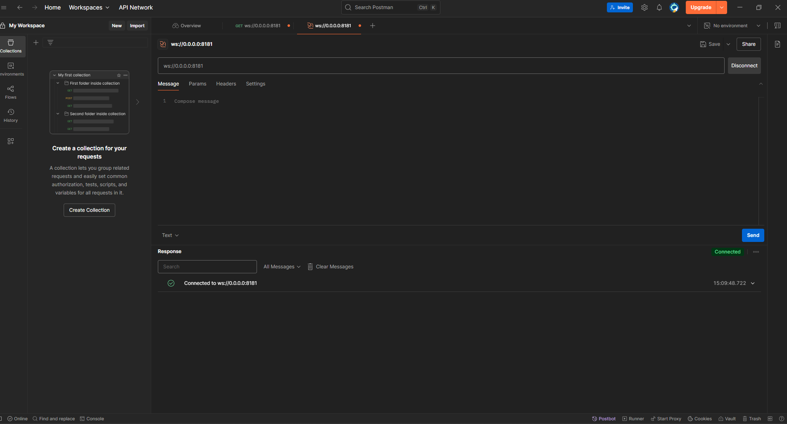
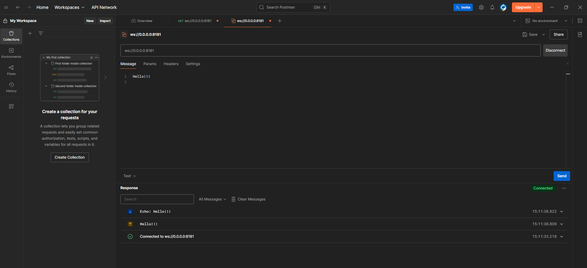
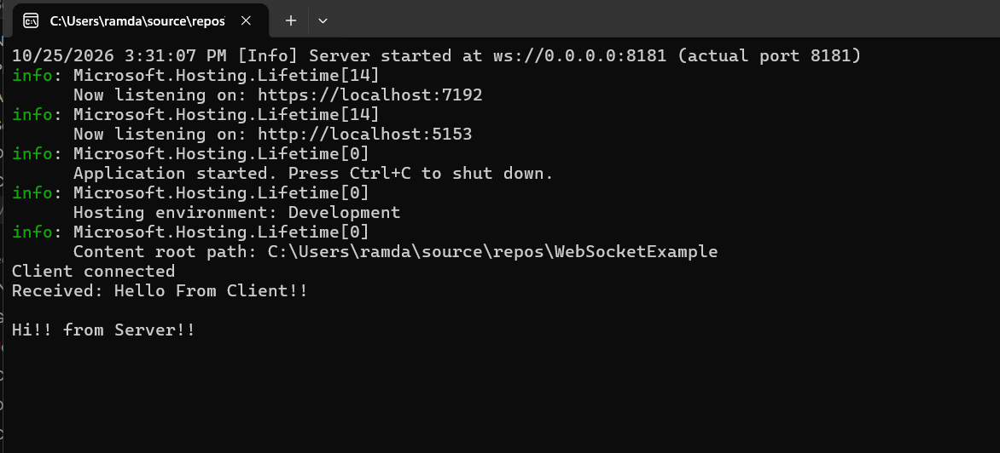
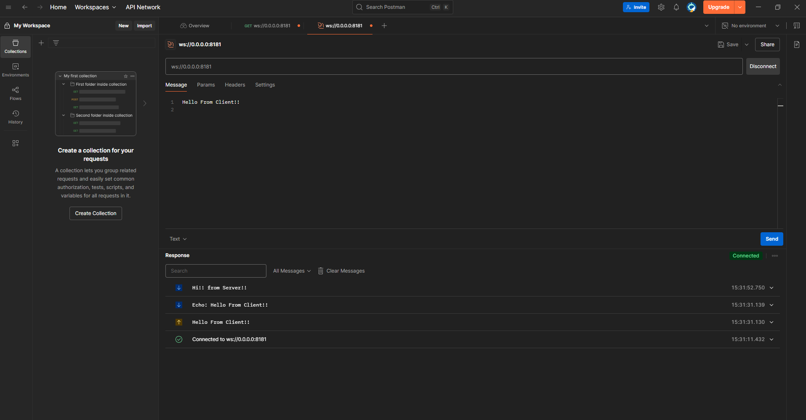

# WebSocketExample

A small .NET example of a WebSocket server built with [Fleck](https://github.com/statianzo/Fleck). It accepts client connections, echoes incoming messages back, and lets you push messages from the server console to every connected client (tested with Postman).

## Tech stack

- .NET (ASP.NET Core Web API template, top-level statements)
- [Fleck](https://www.nuget.org/packages/Fleck) NuGet package for the WebSocket server
- `System.Collections.Concurrent.ConcurrentDictionary` for thread-safe client tracking
- Postman (WebSocket request) as the test client

## Setup

```
dotnet new webapi
dotnet add package Fleck
dotnet run
```

Optional, for Visual Studio: `dotnet new sln` then `dotnet sln add WebSocketExample.csproj`.

## Code

```csharp
using Fleck;
using System.Collections.Concurrent;

var clients = new ConcurrentDictionary<Guid, IWebSocketConnection>();
var server = new WebSocketServer("ws://0.0.0.0:8181");

server.Start(ws =>
{
    ws.OnOpen = () =>
    {
        clients[ws.ConnectionInfo.Id] = ws;   // add the client
        Console.WriteLine("Client connected");
    };
    ws.OnClose = () =>
    {
        clients.TryRemove(ws.ConnectionInfo.Id, out _);   // remove the client
        Console.WriteLine("Client disconnected");
    };
    ws.OnMessage = message =>
    {
        Console.WriteLine($"Received: {message}");
        ws.Send($"Echo: {message}");
    };
});

_ = Task.Run(() =>
{
    while (true)
    {
        var line = Console.ReadLine();
        if (!string.IsNullOrWhiteSpace(line))
            Broadcast(line);
    }
});

void Broadcast(string message)
{
    foreach (var client in clients.Values)
        client.Send(message);
}

WebApplication.CreateBuilder(args).Build().Run();
```

## How it works

1. **Project and package.** A Web API project is created and the Fleck NuGet package is installed. Fleck provides a simple WebSocket server.
2. **Server.** `new WebSocketServer("ws://0.0.0.0:8181")` creates the server. `0.0.0.0` means it accepts connections on all network interfaces, and `8181` is the port. This is separate from the ASP.NET HTTP port (for example 5153).
3. **Per-connection object.** `server.Start(ws => { ... })` runs the lambda once for every new client. The `ws` parameter represents that one client's connection, not the server and not the client application itself.
4. **Event callbacks.**
   - `OnOpen` runs when a client connects. The connection is stored in the `clients` dictionary under its unique ID.
   - `OnClose` runs when a client disconnects. The connection is removed from the dictionary.
   - `OnMessage` runs when the client sends a text message. The server logs it and sends `Echo: <message>` back to that client only.
5. **Client registry.** `clients` maps connection ID (`Guid`) to the connection object (`IWebSocketConnection`). It is a `ConcurrentDictionary` because Fleck invokes callbacks on multiple threads while the console task also reads the collection. A normal `Dictionary` is not safe for that.
6. **Console to clients.** `Task.Run` starts a background thread with an endless `while (true)` loop. It blocks on `Console.ReadLine()`, and every non-empty line you type is passed to `Broadcast`. The loop does not check connection state. It runs for the lifetime of the process.
7. **Broadcast.** `Broadcast` loops over all connections currently in `clients` and calls `Send` on each one. Every connected client receives the message. If nobody is connected, nothing happens.
8. **Keep-alive.** `WebApplication.CreateBuilder(args).Build().Run()` keeps the process running so the Fleck server stays alive.

**Flow:** client connects → `OnOpen` stores it → you type in the console → background task calls `Broadcast` → every stored connection receives the text.

## Testing with Postman

1. Start the app with `dotnet run` (or F5 in Visual Studio).
2. In Postman choose **New > WebSocket** and enter `ws://localhost:8181`.
3. Click **Connect**. The console prints `Client connected`.
4. Type `hello` in the Postman message box and click **Send**. Postman shows `Echo: hello` and the console prints `Received: hello`.
5. Type a message in the server console and press Enter. It appears in Postman's Messages panel.
6. Click **Disconnect**. The console prints `Client disconnected`.

## Screenshots

### Postman connected to the server


### Sending a message and receiving the echo


### Server console output


### Message typed in the console, received in Postman


## Testing from the browser console

```javascript
const ws = new WebSocket("ws://localhost:8181");
ws.onmessage = e => console.log(e.data);
ws.onopen = () => ws.send("hello");
```

## Common pitfalls

- **Messages typed in the console never arrive.** `OnOpen` must add the connection to `clients`. If it only prints, the dictionary stays empty and `Broadcast` sends to nobody.
- **Reconnect after changing code.** Connections made to an old run are gone after a restart, so disconnect and connect again in Postman.
- **Console input under the debugger.** If typing in the console does nothing when debugging in VS Code, use `dotnet run` in the terminal or set `"console": "integratedTerminal"` in `launch.json`.
- **Wrong URL scheme.** Use `ws://`, not `http://`, and port `8181`.

## Possible next steps

- Send to one specific client instead of all (look up the connection by its ID in `clients`).
- Push data on a timer or from a database or sensor.
- Switch to ASP.NET Core's built-in `app.UseWebSockets()` and drop Fleck.
